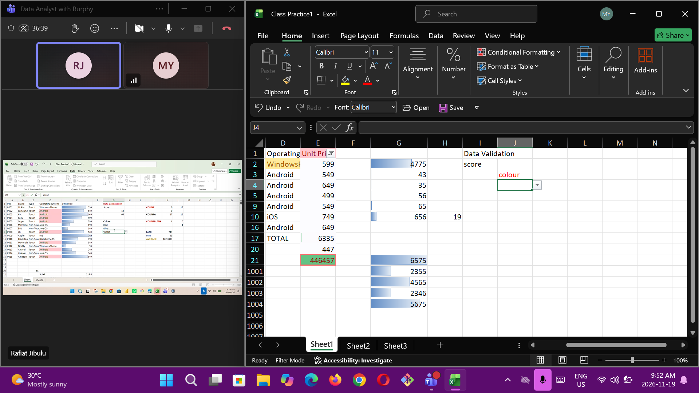

# My Excel Learning Journey: Building Data Analysis Skills

## 1. Introduction

As part of my journey into Data Analysis, I recently started learning Microsoft Excel. My goal is to develop practical spreadsheet skills and understand how Excel can be used to organise, clean, manage and analyse data.

This documentation highlights the topics I have covered, the functions I have practised, and my progress as I continue learning.

## 2. Topics Covered

### A. Basic Statistical Functions

I learned how to use basic statistical functions to summarise and analyse numerical data.

Functions covered:
- `AVERAGE()`
- `MODE()`
- Other basic statistical functions introduced during class.

### B. Text Functions

I learned how to use text functions to manipulate, extract, search and combine text in Excel.

Functions covered:
- `UPPER()` – Converts text to uppercase.
- `LOWER()` – Converts text to lowercase.
- `LEFT()` – Extracts characters from the beginning of text.
- `RIGHT()` – Extracts characters from the end of text.
- `SEARCH()` – Finds the position of a character or text within another text.
- `CONCATENATE()` – Combines text from different cells.
- `CONCAT()` – Combines text from multiple ranges or strings.
- `LEN()` – Counts the number of characters in a text string.

### C. Date and Time Functions

I learned how to work with dates and time-related information in Excel.

Functions covered:
- `DATE()`
- `DAY()`
- `MONTH()`
- `NOW()`
- `YEAR()`

These functions help extract date information and work with dates in spreadsheets.

### D. Sorting and Filtering

I learned how to organise and manage spreadsheet data using:

- **Sorting:** Arranging data in ascending or descending order.
- **Filtering:** Displaying only records that meet selected conditions.

### E. Conditional Formatting

I also learned how to use Conditional Formatting in Excel.

Conditional Formatting allows users to automatically apply formatting to cells based on specified conditions.

It helps to:
- Highlight important values.
- Identify duplicate values.
- Find high and low values.
- Make patterns in data easier to recognise.

## 3. Practical Exercises and Projects

This section will contain examples of the Excel exercises I have completed during my learning process.

## 4. ## My Classroom Learning Experience

I participated in an online Excel training session where I learned and practised different Excel techniques. During the class, I worked on practical exercises using Microsoft Excel.

Some of the topics covered during the session included:

- Conditional Formatting (Data Bars)
- Sorting and Filtering
- Data Validation
- Basic statistical function
- Text function

### Picture of Me During Class

## 5. Learning Outcomes

Through these lessons, I am developing the ability to:

- Use basic Excel functions.
- Manipulate and extract text.
- Work with dates and time.
- Organise data through sorting and filtering.
- Apply Conditional Formatting to identify important information.

  ## My learning journey
| Tool | purpose | status |
| ----- |  ---- |  ---- |
| Exel | Data Analytics | started |
| SQL | Data base Querying | Not started |
| PowerBI | Create report | Not started |
| Python | Data Analysis | Not started |

## 5. Conclusion

Learning Excel is an important step in my journey towards becoming a skilled Data Analyst. I look forward to improving my knowledge, practising more functions and applying what I learn to real-world data.

